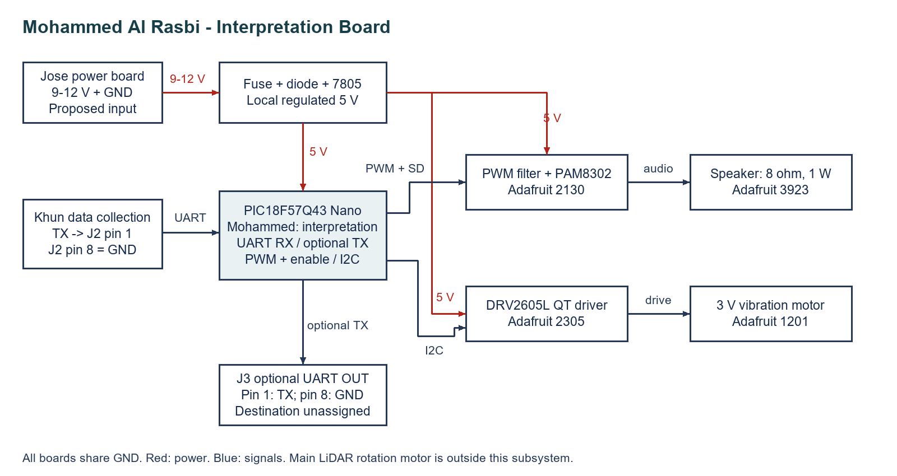

## Overview

**Mohammed Al Rasbi - Interpretation Board**

My board receives LiDAR data from Khun's collection board, interprets obstacle information, and provides speaker and vibration alerts. The vibration motor sits in the grip. The main LiDAR rotation motor belongs to the scanning subsystem.

**Figure 1:** Current interpretation subsystem, matching simplified schematic D-simple.

## Connections and design decisions

| Interface | Connection |
|---|---|
| Power | Proposed 9-12 V from Jose through fuse, diode and local 7805 regulator. The Nano and both driver modules use 5 V. |
| Data input | Khun TX to J2 pin 1, then Nano RC3/RX, pin 8. J2 pin 8 is common GND. |
| Optional data output | Nano RC2/TX, pin 7, to J3 pin 1. Destination remains unassigned; leave unused unless needed. J3 pin 8 is GND. |
| Speaker | RB0 PWM through the filter to PAM8302; RB3 controls shutdown. Speaker connects across amplifier outputs. |
| Vibration | RB1/SCL and RB2/SDA connect to DRV2605L. Configure the driver for the 3 V ERM motor. |

Pins 2-7 on J2 and J3 are unused. All boards need a common ground and compatible UART signal voltage; confirm the collection board's levels before integration.

The controller separates range processing from the higher-current actuators. Audio and vibration offer two nonvisual feedback methods. Local regulation supplies the electronics, while the driver modules power the loads. This revision replaces the original PWM motor-driver proposal with I2C and matches the separate UART input/output headers in the schematic.

## Downloads

- [Editable draw.io diagram](Mohammed-Block-Diagram.drawio)
- [Diagram image and source ZIP](Mohammed-Block-Diagram.zip)
- [Detailed schematic](../04-Schematic/schematic.md)
