# Component Selection

**Mohammed Al Rasbi - Interpretation Board**

Prices checked October 21, 2026 (USD, quantity one; tax and shipping excluded).

## Audio amplifier

| Solution | Pros | Cons |
|---|---|---|
| **Option 1: Adafruit 2130 - PAM8302A module** 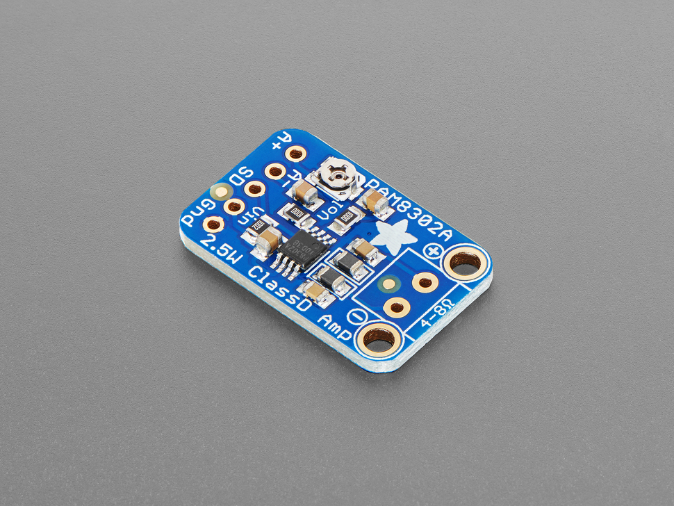{ width="150" } $3.95 each [Product link](https://www.adafruit.com/product/2130) | - One channel matches the required warning speaker.  - Small module and input trim simplify assembly and level adjustment. | - Needs analog audio conditioning from PWM.  - Available output can exceed the selected speaker rating; limit drive. |
| **Option 2: Adafruit 987 - MAX98306 module** 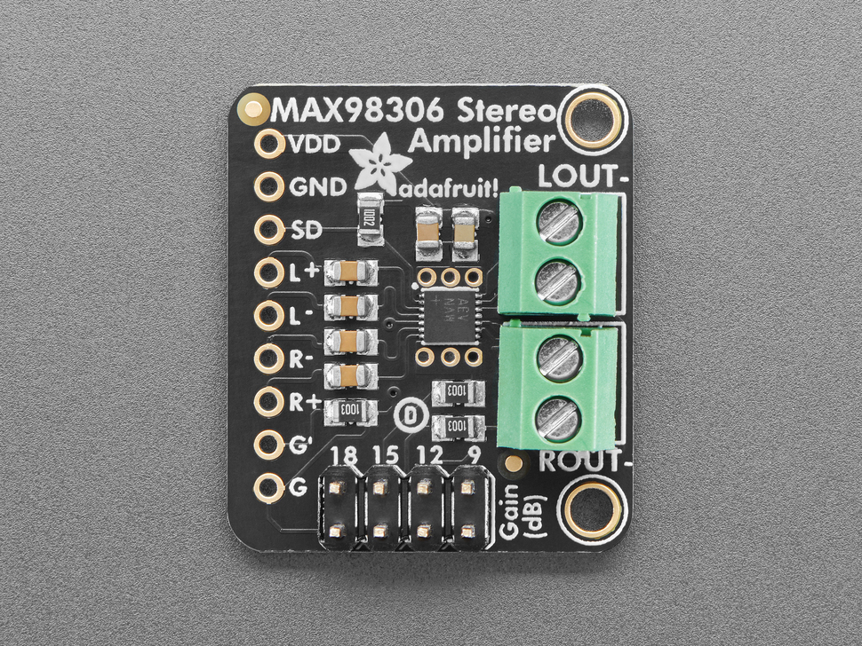{ width="150" } $8.95 each [Product link](https://www.adafruit.com/product/987) | - Selectable gain provides useful volume headroom.  - Two channels allow a later left/right audio experiment. | - Second channel is unnecessary in this design.  - Higher price than the mono option; speaker power still needs limiting. |
| **Option 3: Adafruit 1552 - TPA2012 module** 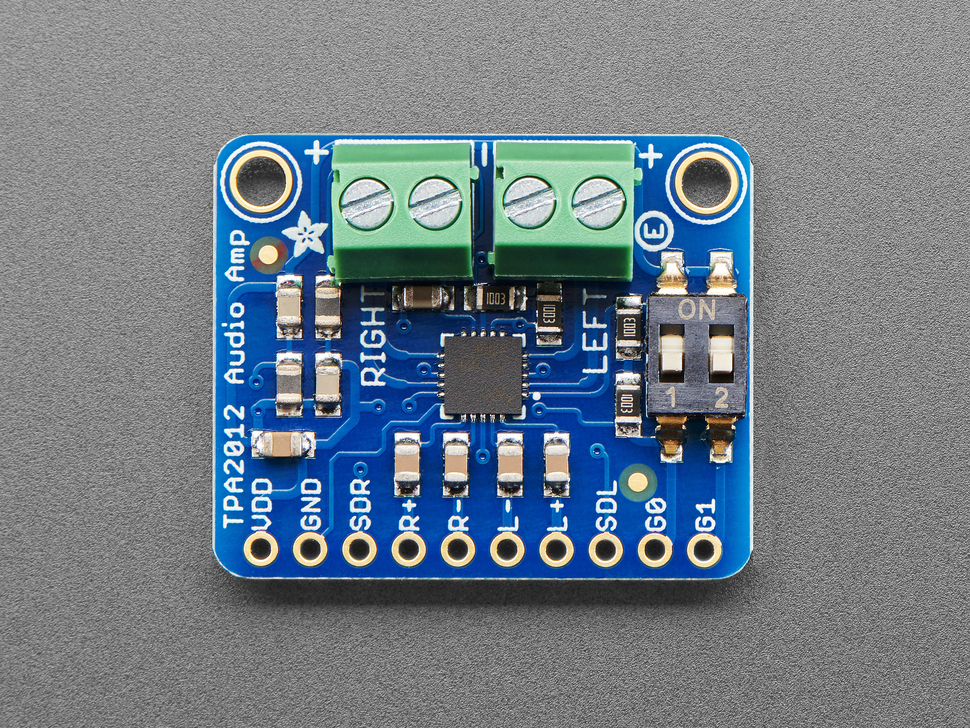{ width="150" } $9.95 each [Product link](https://www.adafruit.com/product/1552) | - Gain switches simplify prototype tuning.  - Built-in protection and analog inputs suit a breadboard prototype. | - Costs more than the selected mono module.  - Unused stereo channel and short-speaker-wire guidance complicate packaging. |

**Choice:** Adafruit 2130 / PAM8302A

**Rationale:** The PAM8302A is compact, inexpensive, and provides the single audio channel needed for warning tones. Its volume trim makes adjustment easier; filter and attenuate the PIC PWM signal and keep output within the speaker rating.

*Product photos and specifications: linked supplier pages.*

## Speaker

| Solution | Pros | Cons |
|---|---|---|
| **Option 1: Adafruit 3923 - mini oval** 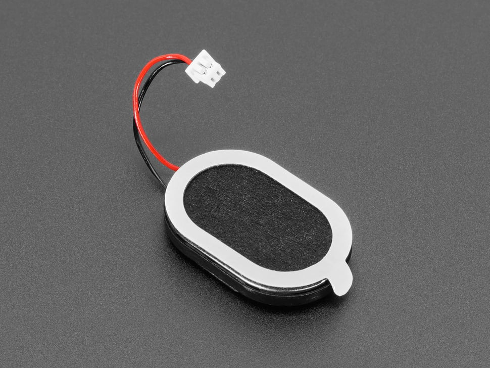{ width="150" } $1.95 each [Product link](https://www.adafruit.com/product/3923) | - Compact shape fits a handheld body.  - 1 W rating offers more margin than the mini metal option. | - Supplier page currently says out of stock.  - Short lead and enclosure opening require mechanical planning. |
| **Option 2: Adafruit 1890 - mini metal** 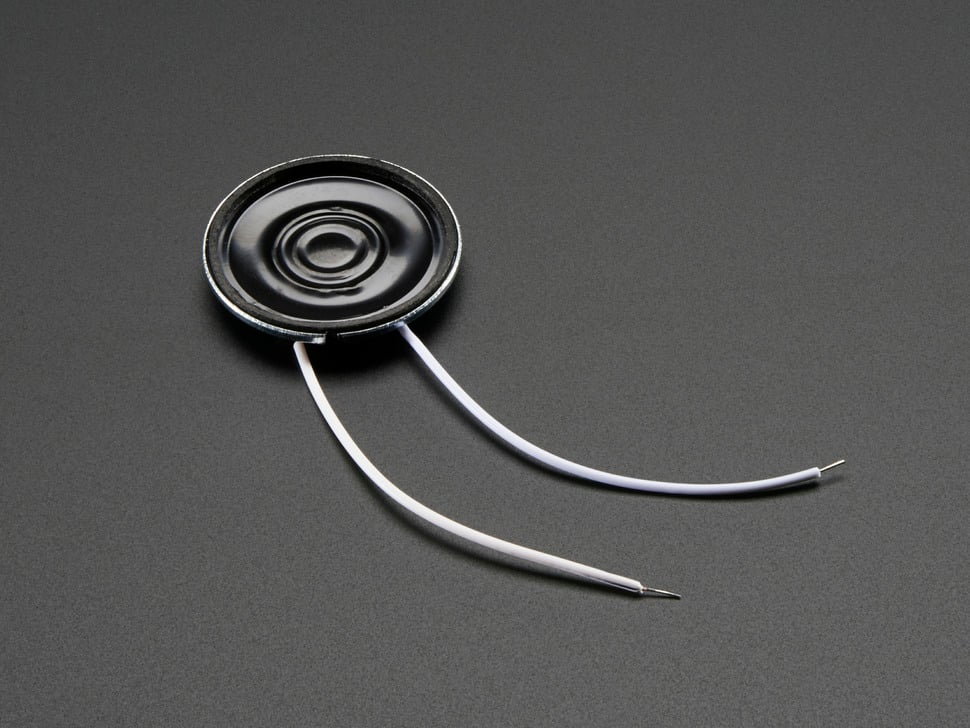{ width="150" } $1.95 each [Product link](https://www.adafruit.com/product/1890) | - Small, shallow package is easy to place.  - Attached wires simplify prototype connections. | - Lower continuous rating requires stricter volume limiting.  - Listed out of stock; title and detailed power ratings differ, so use 0.25 W rated. |
| **Option 3: Adafruit 1313 - 3-inch speaker** 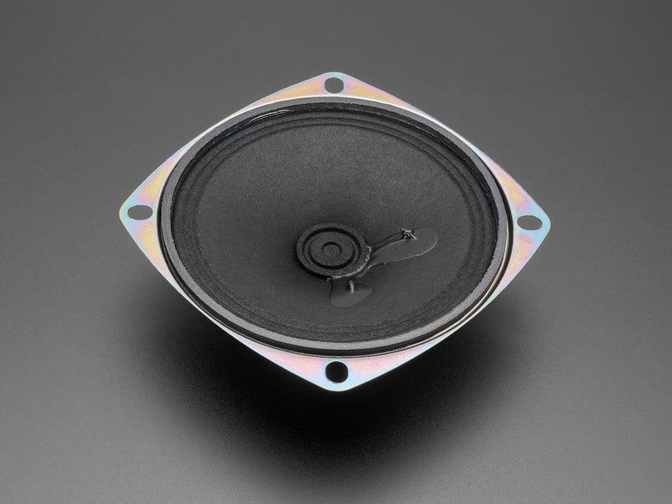{ width="150" } $1.95 each [Product link](https://www.adafruit.com/product/1313) | - Mounting tabs provide a secure attachment method.  - Compatible impedance and power class for the mono amplifier. | - Large diameter and depth consume handheld space.  - Heavier than the oval option and currently listed out of stock. |

**Choice:** Adafruit 3923 mini oval speaker

**Rationale:** The oval speaker fits the handheld enclosure better than the larger round option and has a higher power rating than the mini metal speaker. It is the preferred design choice, but its listed stock shortage must be resolved before ordering.

*Product photos and specifications: linked supplier pages.*

## Vibration motor driver

| Solution | Pros | Cons |
|---|---|---|
| **Option 1: Adafruit 2305 - DRV2605L** 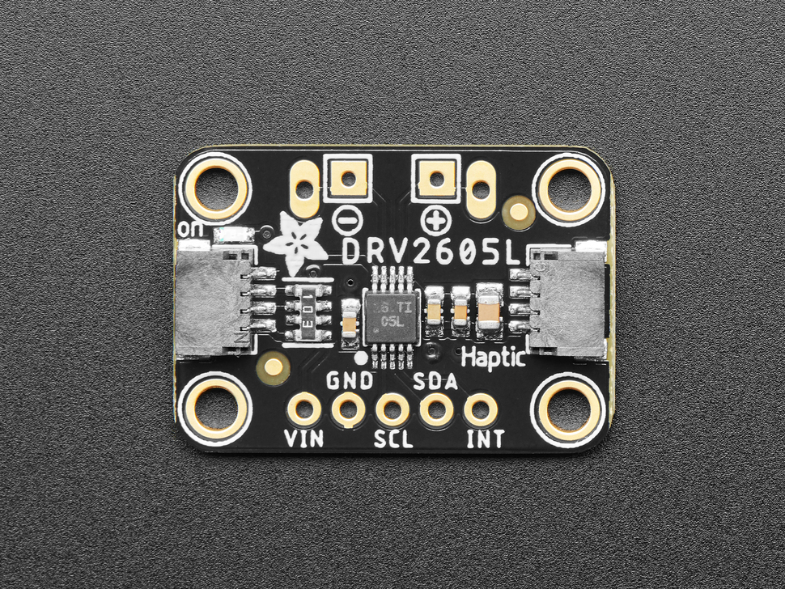{ width="150" } $7.95 each [Product link](https://www.adafruit.com/product/2305) | - Built-in effects help distinguish warning states.  - Two I2C signals reduce timing work in the PIC. | - Requires register initialization and motor calibration/settings.  - Costs more than the generic H-bridge and changes the earlier PWM interface. |
| **Option 2: Adafruit 3297 - DRV8833** 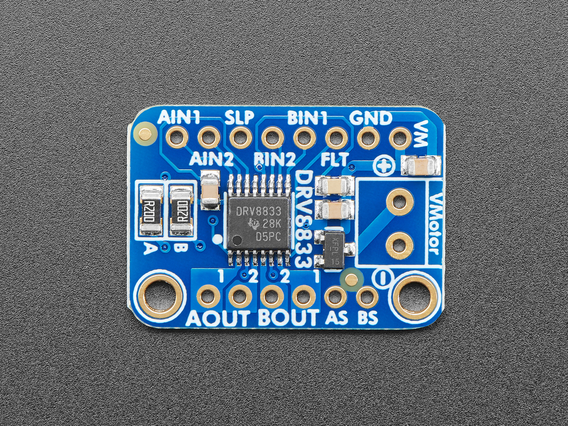{ width="150" } $5.95 each [Product link](https://www.adafruit.com/product/3297) | - Low-voltage operation suits a roughly 3 V motor.  - Protection and current-limiting capability simplify experiments. | - No built-in haptic effect sequencing.  - Second bridge is unused; default current limit is far above this small motor load. |
| **Option 3: Adafruit 2448 - TB6612** 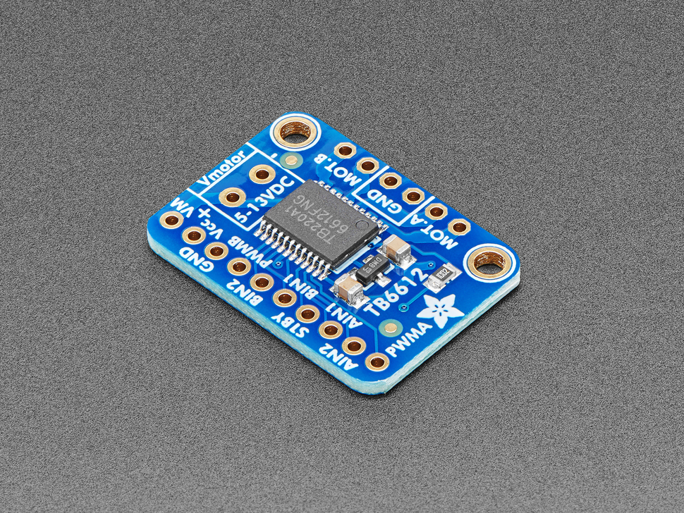{ width="150" } $6.95 each [Product link](https://www.adafruit.com/product/2448) | - Separate motor and logic rails can suit larger actuators.  - Supports direction and speed control with standard digital signals. | - Supplier recommends 4.5-13.5 V motors; poor fit for the selected 3 V ERM.  - Extra control pins and unused bridge add complexity; rejected for this design. |

**Choice:** Adafruit 2305 / TI DRV2605L

**Rationale:** The DRV2605L provides built-in vibration effects and reduces the software needed to create distinct alerts. Use I2C instead of the earlier PWM-only interface and configure the driver for the selected ERM motor.

*Product photos and specifications: linked supplier pages.*

## Vibration motor

| Solution | Pros | Cons |
|---|---|---|
| **Option 1: Adafruit 1201 - vibrating disc** 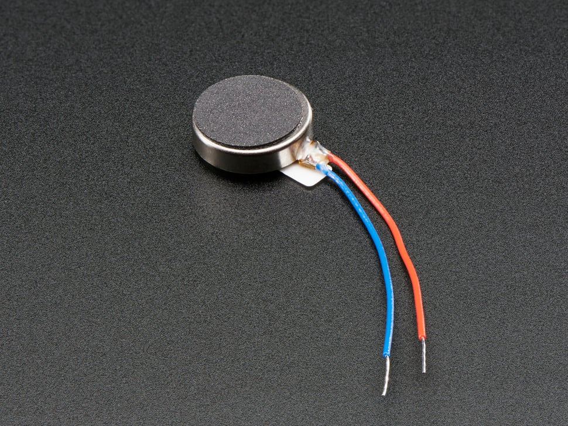{ width="150" } $1.95 each [Product link](https://www.adafruit.com/product/1201) | - Enclosed mechanism avoids exposed rotating mass.  - Low price and compact disc suit grip mounting. | - Requires a driver and controlled motor voltage.  - Mounting stiffness strongly affects feedback; supplier sheet/model consistency needs checking. |
| **Option 2: Pololu 1637 - shaftless 8 mm** 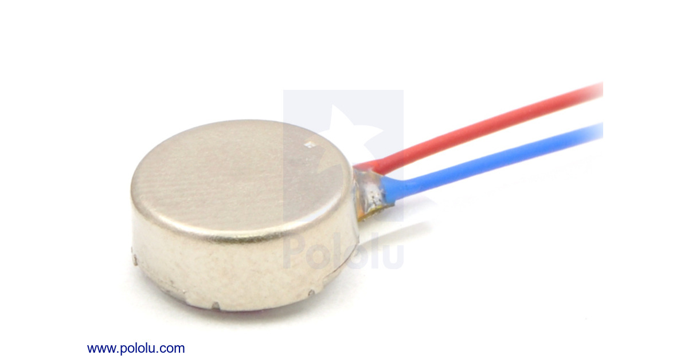{ width="150" } $6.95 each [Product link](https://www.pololu.com/product/1637) | - Smaller diameter fits a narrow grip.  - Adhesive backing and specified startup current aid integration. | - Higher price than the selected disc.  - Supplier shows backorder availability; smaller force needs grip testing. |
| **Option 3: Pololu 2265 - cylindrical ERM** 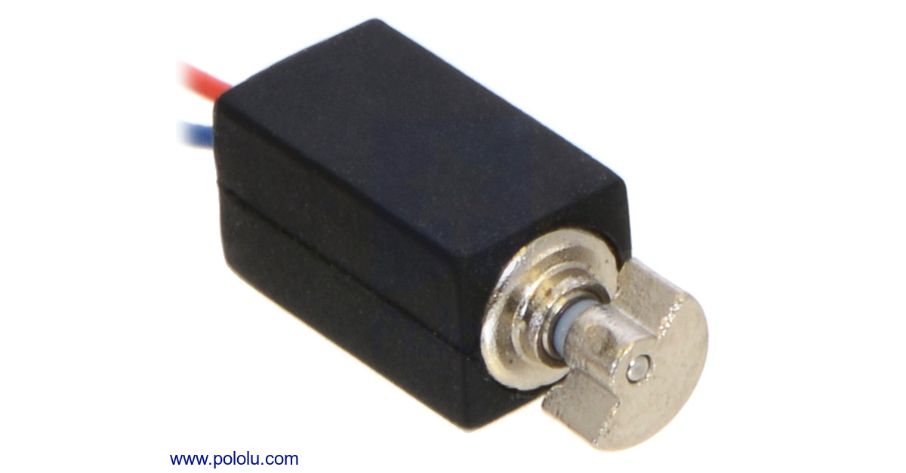{ width="150" } $6.95 each [Product link](https://www.pololu.com/product/2265) | - Flat-sided sleeve helps secure the motor.  - Narrow profile can fit along the grip wall. | - Exposed eccentric mass needs clearance.  - Backorder availability and higher price make it less attractive. |

**Choice:** Adafruit 1201 vibrating disc

**Rationale:** The enclosed disc is small, inexpensive, and easy to mount inside the grip. Drive it through the DRV2605L at a nominal 3 V motor setting, then test the strength of the vibration in the enclosure.

*Product photos and specifications: linked supplier pages.*

## Local power regulation

| Solution | Pros | Cons |
|---|---|---|
| **Option 1: Adafruit 2164 - 7805 TO-220** 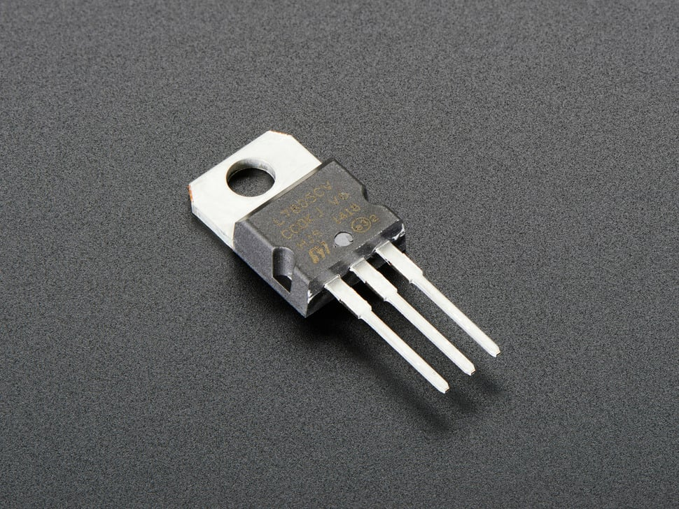{ width="150" } $0.75 each [Product link](https://www.adafruit.com/product/2164) | - Through-hole package is practical for a custom student PCB.  - Low unit cost and fixed output avoid adjustment errors. | - Needs input headroom, capacitors and thermal design.  - Heat reduces battery efficiency; verify actual manufacturer/marking before purchase. |
| **Option 2: Adafruit 184 - MIC2941 kit** 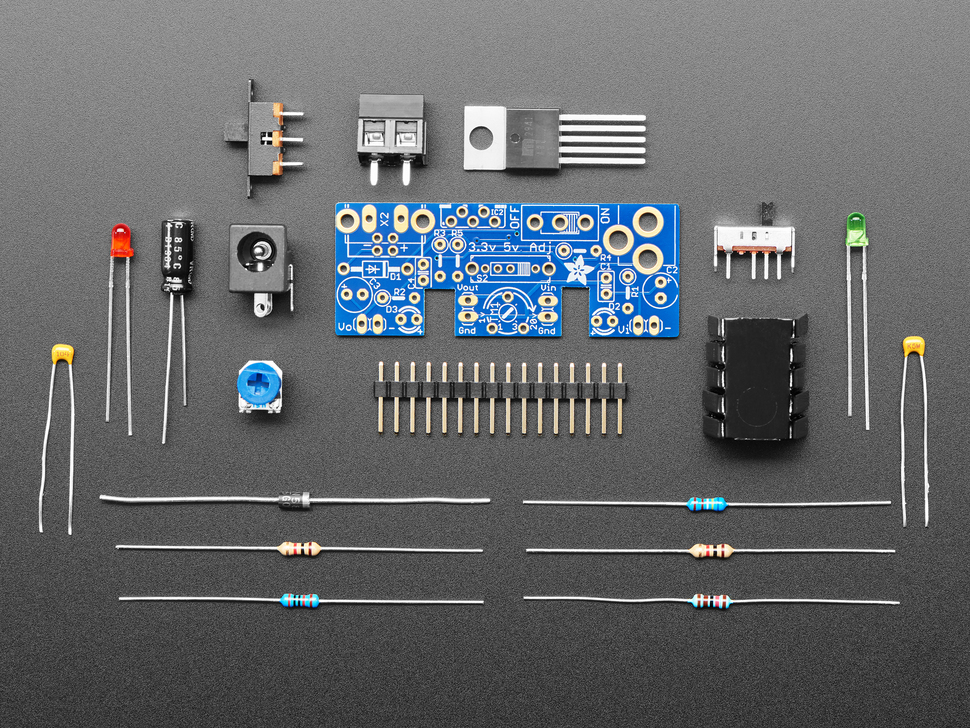{ width="150" } $14.95 each [Product link](https://www.adafruit.com/product/184) | - Lower dropout increases input-voltage flexibility.  - Kit includes heatsink and prototyping connections. | - Large assembled kit and higher cost hurt handheld integration.  - Listed out of stock; linear heat loss remains despite lower dropout. |
| **Option 3: Pololu 5433 - D45V5F5** 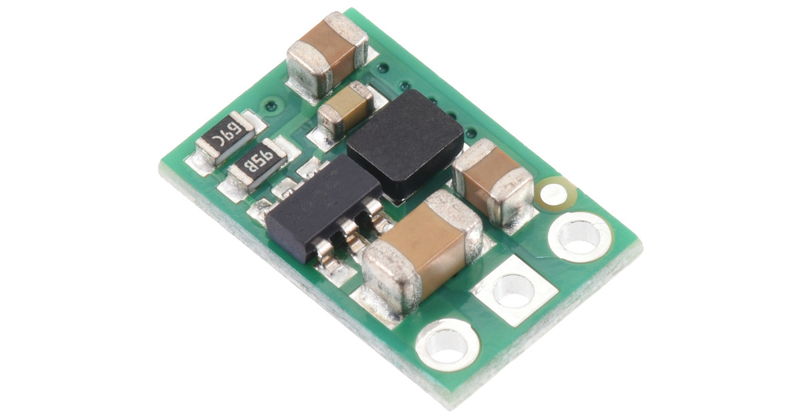{ width="150" } $5.75 each [Product link](https://www.pololu.com/product/5433) | - Switching conversion can reduce battery losses.  - Very small board with simple VIN/GND/VOUT connections. | - Switching-only solution does not meet the stated linear-regulator direction.  - Current capability depends on input and temperature; rejected as sole local regulator. |

**Choice:** 7805-based local linear regulator circuit

**Rationale:** The 7805 is inexpensive, easy to solder, and supports the required local linear-regulator approach. This choice depends on Jose supplying at least 7 V under load; confirm that input and calculate heatsink requirements before building.

*Product photos and specifications: linked supplier pages.*
