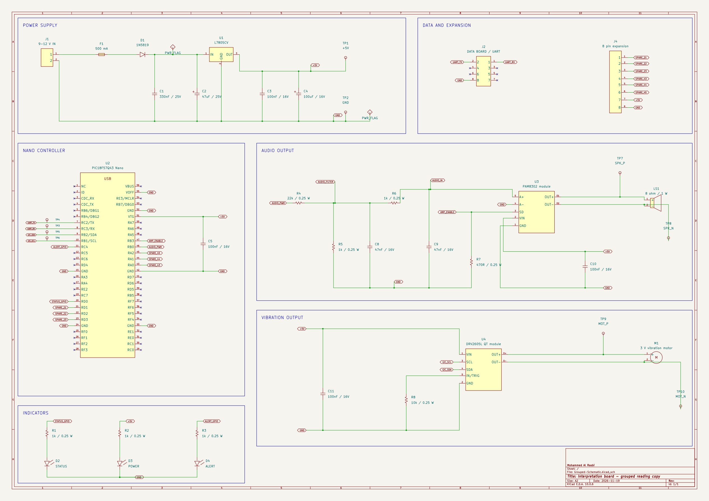
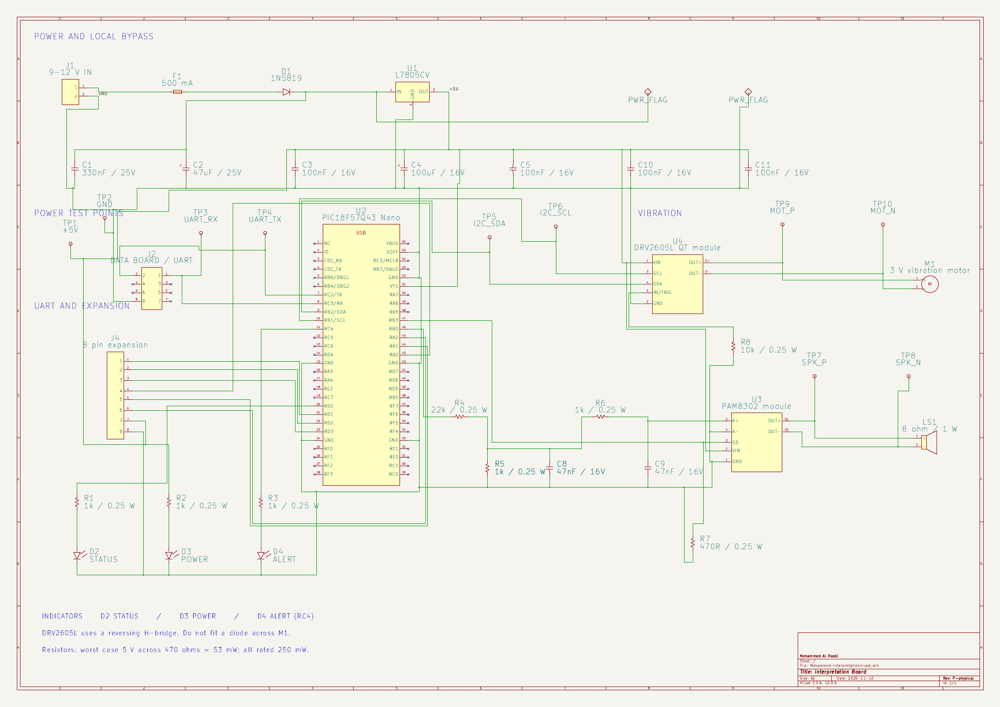

# Schematics

Mohammed Al Rasbi | Team 105 | Interpretation board

The Nano receives distance data over UART and controls the speaker amplifier and vibration driver. The power section supplies 5 V to the controller and drivers.

## Grouped schematic

This one-page layout groups the power supply, Nano controller, data and expansion connectors, audio output, vibration output, and indicators into separate sections. Matching labels connect the sections electrically.

[Download the grouped schematic PDF](Grouped-Schematic.pdf) | [Download the grouped KiCad schematic project](Grouped-KiCad.zip)

## Fully wired schematic

This layout shows the original wiring between the board's sections.

[Download the fully wired schematic PDF](Schematic.pdf) | [Download the PCB and original KiCad project](../06-PCB-Design/Project.zip)
