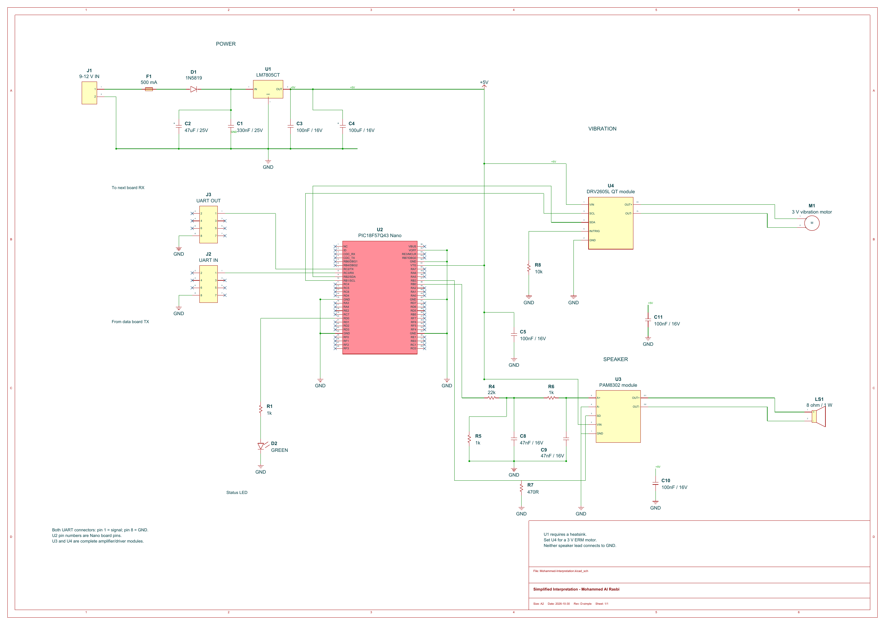

## Overview

**Mohammed Al Rasbi - Interpretation Board**

The controller receives LiDAR data and converts obstacle information into sound and vibration. This gives the user feedback without needing to look at a screen.

**Figure 1:** Simplified interpretation-board schematic, revision D-simple.

## How it works

- **Power:** J1 accepts a proposed 9-12 V input from Jose's power board. F1 and D1 protect the input; U1 produces 5 V for the Nano and driver modules. Capacitors reduce supply disturbances. U1 requires a heatsink.
- **Controller:** U2 is the complete PIC18F57Q43 Curiosity Nano. Its firmware will interpret incoming range information and select warning patterns. Pin numbers refer to the Nano board connector.
- **Data input:** J2 pin 1 receives Khun's TX signal and connects to RC3/RX, Nano pin 8. J2 pin 8 is common ground.
- **Optional data output:** RC2/TX, Nano pin 7, connects to J3 pin 1. No receiving board is assigned yet; leave J3 unconnected unless the team needs forwarding. J3 pin 8 is ground. Pins 2-7 on both UART headers are unused.
- **Sound:** RB0 supplies PWM audio through R4/R5/C8/R6/C9 to the PAM8302 amplifier. RB3 enables the amplifier. The speaker connects across OUT+ and OUT-, with neither lead connected to ground. The power estimate assumes a reduced 0.25 W audio target, which must be checked by measurement.
- **Vibration:** RB1/SCL and RB2/SDA command the DRV2605L over I2C. Its two output leads drive the grip motor. Configure it for the selected 3 V ERM motor; the driver itself receives 5 V.
- **Status:** RD0 drives the status LED through R1.

Audio and tactile outputs provide two feedback methods. Compact modules simplify assembly inside the handheld enclosure. The simplified design omits the previous debug button, expansion header, test points and isolation jumpers.

## Resources

- [Schematic PDF](Mohammed-Interpretation-Schematic.pdf)
- [Editable KiCad project and custom symbols ZIP](Mohammed-Interpretation-KiCad.zip)
- [Proposed controller configuration](../02-Component-Selection/Component-Selection.md#proposed-mcc-configuration)
- [Estimated power budget](../05-Power-Budget/Power-Budget.md)

## Verification status

The schematic's intended connections were checked programmatically. Native KiCad ERC, firmware operation and hardware performance have not been verified. Confirm compatible UART logic levels before connecting boards.

## References

- [Microchip Nano hardware guide](https://ww1.microchip.com/downloads/aemDocuments/documents/MCU08/ProductDocuments/UserGuides/PIC18F57Q43-Curiosity-Nano-HW-UserGuide-DS40002186B.pdf)
- [PAM8302 connections](https://learn.adafruit.com/adafruit-pam8302-mono-2-5w-class-d-audio-amplifier/pinouts)
- [DRV2605L connections](https://learn.adafruit.com/adafruit-drv2605-haptic-controller-breakout/pinouts)
