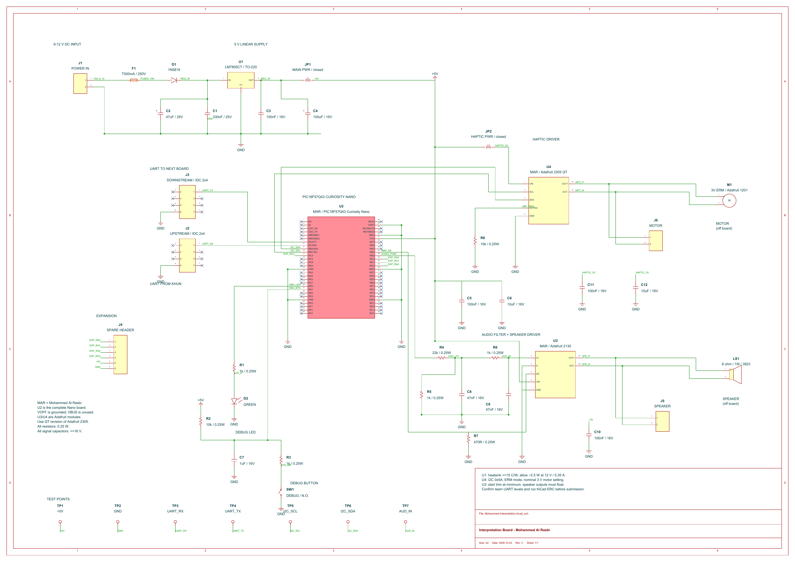

## Overview

**Mohammed Al Rasbi — Interpretation Board**

This board receives LiDAR data and provides speaker tones and vibration alerts to help visually impaired users detect nearby obstacles.

The circuit uses a **PIC18F57Q43 Curiosity Nano**, a **PAM8302 audio amplifier**, and a **DRV2605L vibration motor driver**. A fused **9–12 V input** supplies a **7805 regulator**, which provides **5 V power**.

## Schematic

**Figure 1:** Interpretation-board schematic showing the power supply, controller, speaker and vibration circuits, team connections, and debugging components.

## Resources

- [Download the schematic PDF](Mohammed-Interpretation-Schematic.pdf)
- [Download the KiCad project and custom symbols](Mohammed-Interpretation-KiCad.zip)

## Review Status

This design has not been bench-tested. KiCad’s electrical rules check and confirmation of the team’s UART connections are still required.
