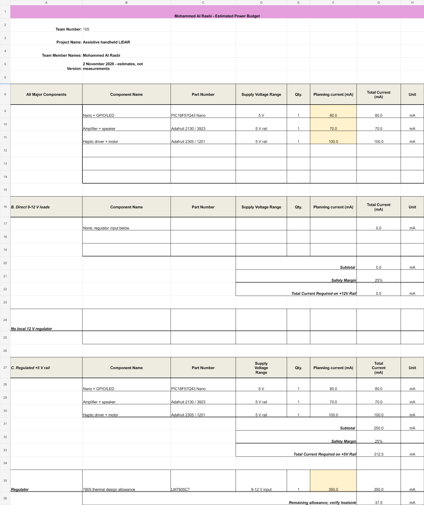
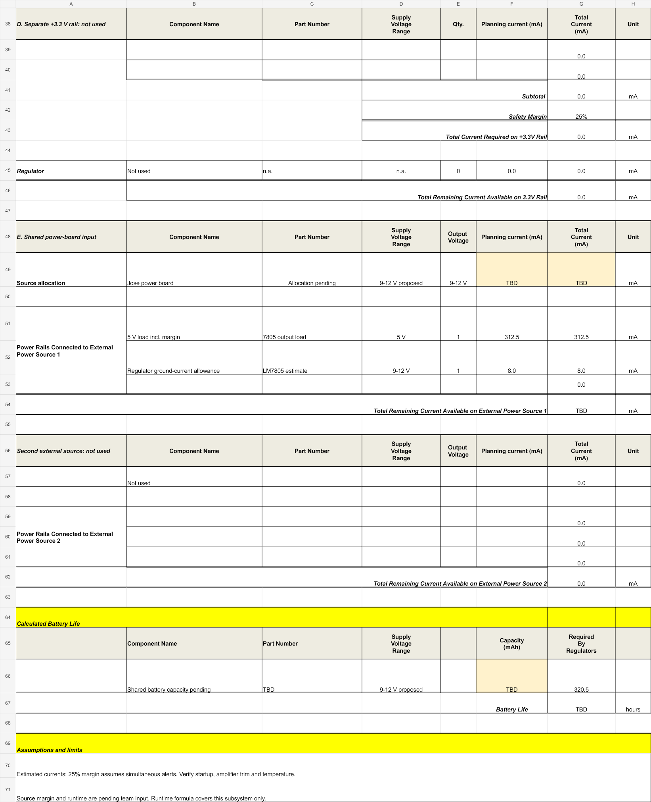
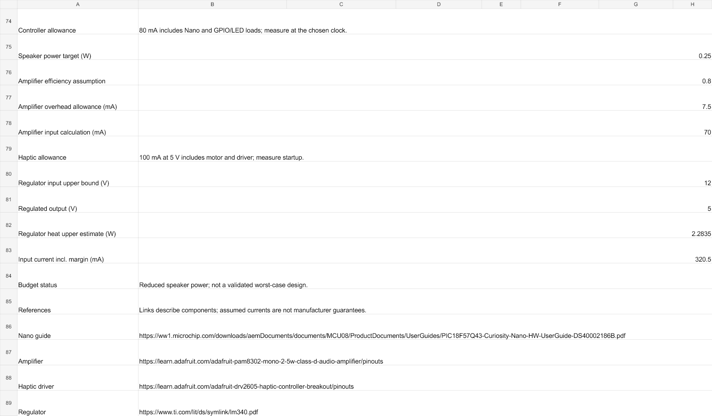

## Overview

**Mohammed Al Rasbi - Interpretation Board**

This estimated budget uses the course spreadsheet template and the simplified schematic. It assumes simultaneous sound and vibration. These are planning allowances, not measured currents or guaranteed maximum ratings.

## Estimated 5 V loads

| Load | Current allowance | Basis |
|---|---:|---|
| Curiosity Nano, GPIO and status LED | 80 mA | Board-level allowance including control-pin loads; measure at the selected clock. |
| PAM8302 and speaker | 70 mA | 0.25 W audio / (5 V x 80% assumed efficiency), plus 7.5 mA overhead. |
| DRV2605L and vibration motor | 100 mA | Combined input allowance; verify startup and selected vibration effects. |
| **Subtotal** | **250 mA** | Speaker and motor are included in their driver rows, not counted twice. |
| **Including 25% margin** | **312.5 mA** | 250 x 1.25. |

## Conclusions

The 312.5 mA estimate leaves 37.5 mA below the proposed 350 mA continuous regulator design allowance. That allowance depends on adequate heatsinking; it is not a tested regulator limit.

Adding an estimated 8 mA regulator ground current gives approximately **320.5 mA from the shared input**. At 12 V input, regulator dissipation is approximately **2.28 W**: (12 - 5) x 0.3125 + 12 x 0.008. This conservatively ignores the series diode's voltage drop in the regulator calculation. The diode also produces heat.

The budget shows why a heatsink and limited speaker power matter. At a 1 W speaker output, the same assumptions would require approximately 547 mA on the 5 V rail including margin, exceeding the 350 mA design allowance. Test the output level and adjust the design if louder alerts are needed.

Jose's available current allocation, shared battery capacity and full-team load are not confirmed. Source margin and battery runtime therefore remain **TBD**. The 500 mA fuse is protection, not proof that startup current or thermal performance is acceptable.

## Course template

## Downloads

- [Editable power-budget spreadsheet](Mohammed-Power-Budget.xlsx)
- [Power-budget spreadsheet ZIP](Mohammed-Power-Budget.zip)

Before hardware integration, replace the estimates with measurements at maximum intended alert settings and confirm the power-board allocation.
