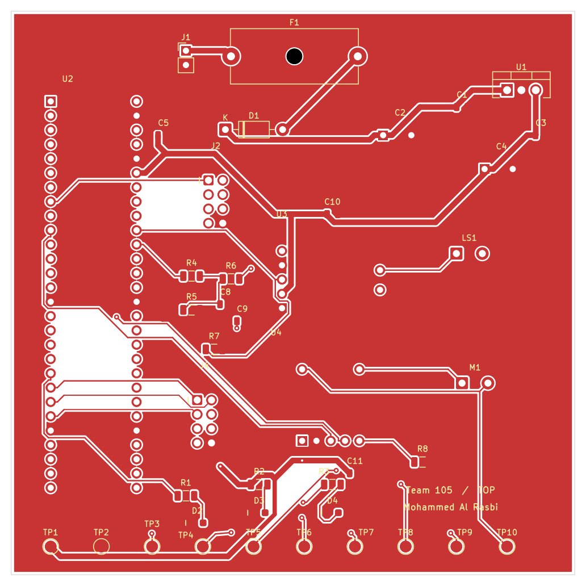
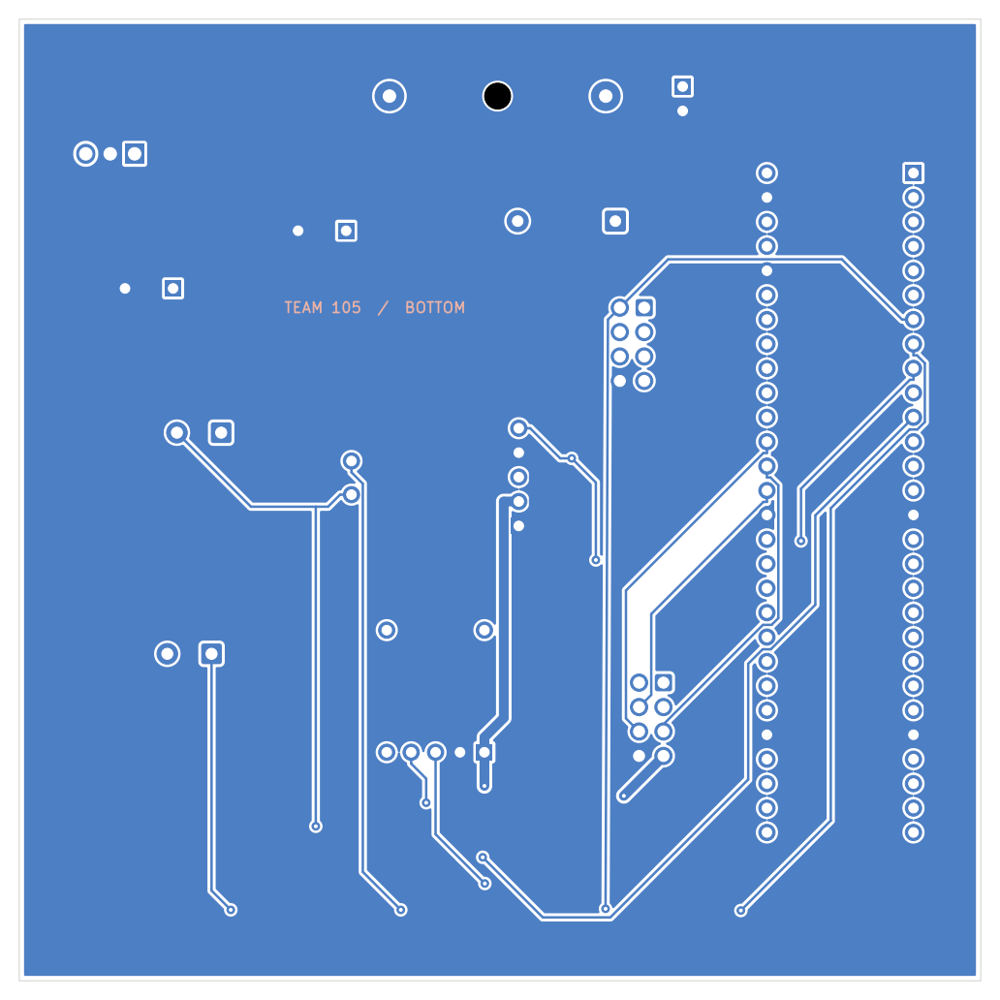

# PCB Design

Mohammed Al Rasbi | Team 105 | Interpretation board

The 100 × 100 mm, two-layer board uses a PIC18F57Q43 Curiosity Nano to turn distance data into sound and vibration. The November 20 footprint revision updates the connector and regulator drills, LED pads, and heatsink clearance.

| Front copper and silkscreen | Back copper and silkscreen |
| --- | --- |
|  |  |
| [Front PDF](Front.pdf) | [Back PDF](Back.pdf) |

- [Gerbers and drill files](AlRasbi_Mohammed_Team105.zip)
- [Editable KiCad project](Project.zip)
- [Printable 1:1 fit sheet](PCB-1to1-Fit.pdf)
- [One-board DigiKey order list](DigiKey-Order-List.csv)

KiCad reports zero DRC violations, zero unconnected items, zero schematic-to-PCB discrepancies, and zero schematic ERC messages. [DRC report](DRC.rpt) · [ERC report](ERC.rpt)

Run a new manufacturer DFM check on the Gerber ZIP above. The [November 17 JLCDFM report](AlRasbi_Mohammed_DFM.pdf) documents the preceding revision.
